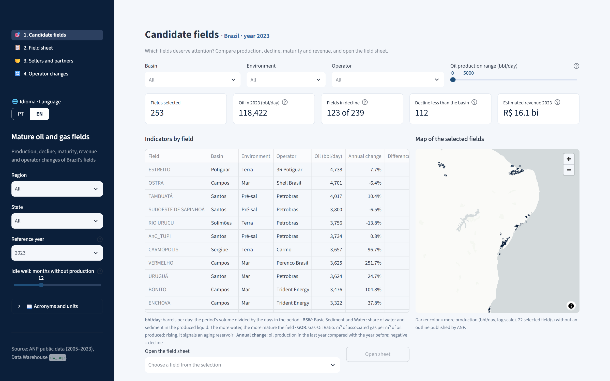

# anp-oil-gas-dw

[Português](README.md) | **English**

> The code, the tables and the project documents are in Portuguese, because the
> data comes from a Brazilian agency and keeps its original names. This page and
> the [Glossary](#glossary) are enough to run and reuse the project.

## What this project is

A **reusable BI pipeline** over the public data of ANP (Brazil's National Agency
of Petroleum, Natural Gas and Biofuels):

```
files downloaded from ANP → ETL 1 → stage (st_anp) → ETL 2 → Data Warehouse (dw_anp) → web dashboard (Streamlit)
```

The pipeline is always the same. What changes is the data: anyone can download
new files from the ANP website, save them under `data/raw/anp/`, run the
pipeline and see the new data in the dashboard. The step-by-step guide is in
[How to update the data](#how-to-update-the-data-manual-extraction).



*The web dashboard in English, on the **Candidate fields** screen: the 253 fields that produced in 2023, with
production, decline, revenue and the field outlines published by ANP. The **🌐 PT | EN** button switches the language.*

## Quick start

To reproduce everything from the data published by ANP (Windows commands; on
Linux or macOS, replace `.venv/Scripts/` with `.venv/bin/` and `copy` with `cp`):

1. Install **PostgreSQL 17** and **Python 3.11** or newer.
2. Create the environment and copy the configuration template. Then fill in the
   PostgreSQL password (`PGPASSWORD`) in `.env`:

```sh
py -3 -m venv .venv
.venv/Scripts/python -m pip install -r requirements.txt
copy .env.exemplo .env
```

3. Create the databases and the tables:

```sh
psql -U postgres -d postgres -f database/criar_bancos.sql
psql -U postgres -d st_anp -f database/st/criar_tabelas.sql
psql -U postgres -d dw_anp -f database/dw/dim_data.sql
psql -U postgres -d dw_anp -f database/dw/criar_tabelas.sql
```

4. Load the stage, in one of two ways:
   - from the **16 CSVs of the source base**, attached to the Releases (section
     [Source base](#source-base-the-16-stage-tables-as-csv)), without
     downloading the ANP files;
   - from the **raw ANP files** (section
     [How to update the data](#how-to-update-the-data-manual-extraction)).
5. Run the pipeline (ETL 1 → ETL 2 → validation) and open the dashboard at
   <http://localhost:8765>:

```sh
.venv/Scripts/python pipeline.py
.venv/Scripts/python -m painel_web
```

## Questions the dashboard answers

Each question has its data in the Data Warehouse and a screen in the dashboard. The
codes (RQ-01 to RQ-09) appear in the code, in the tests and in the screen titles.

| Code | Question | Screen |
| --- | --- | --- |
| RQ-01 | How does the production of each field (oil, condensate, gas and water) evolve, month by month and year by year, since 2005? | Ficha do campo (field sheet) |
| RQ-02 | What is the yearly decline of the field's oil and gas production, compared with its basin? | Ficha do campo and Campos candidatos |
| RQ-03 | How mature is the field (BSW and GOR)? | Ficha do campo and Campos candidatos |
| RQ-04 | How many wells produce and which ones are idle, with how much they produced before stopping? | Ficha do campo |
| RQ-05 | What is the field's estimated revenue (production × oil price published by ANP)? | Ficha do campo |
| RQ-06 | Who operates each field (operator, economic group and country) and who are the likely sellers? | Vendedores e sócios (sellers and partners) |
| RQ-07 | Did the fields improve after the operator change (a sale or a reorganization within the same group)? | Trocas de operador (operator changes) |
| RQ-08 | Who are the partners of each contract, with each one's share? | Vendedores e sócios |
| RQ-09 | Which fields deserve attention, compared side by side and on the outline map? | Campos candidatos (candidate fields) |

## Source base: the 16 stage tables as CSV

To **make review and auditing easier**, the stage is also published ready to
use, as **16 CSV files, one per table**, plus a `manifesto.csv`. This way the
transactional database can be recreated directly, without downloading the
~110 MB of raw ANP files and without running ETL 1.

**Where the 16 CSVs come from:** they **do not replace the ANP files**. They are
generated **from them**: the 375 raw files (zips, CSVs and the CSV extracted from
the 2005–2008 PDFs) were loaded into the stage by ETL 1, and each of the 16
resulting tables was exported to a CSV.

```
378 ANP files → ETL 1 → st_anp (16 tables) → export → 16 CSVs + manifesto.csv
```

- **Content:** the tables exactly as ETL 1 wrote them, with the same IDs. It is
  a **structural load**: the ANP data is only reorganized into tables, with no
  corrections. Duplicates, old field names and units stay as ANP published them.
  The corrections are made in ETL 2 and recorded, with their justification, in
  [`docs/etl/tratamentos.md`](docs/etl/tratamentos.md).
- **Traceability:** each row points to its load (`id_carga`), and the `carga`
  table holds the name and the SHA-256 of the raw file it came from. The
  download links of each source are in the [Data](#data) section.
- **Where it is:** as an asset of the GitHub **Releases** of this repository.
- **Still updatable:** the stage recreated from the CSVs accepts new ETL 1 loads
  normally. Files already loaded are recognized by their hash and skipped, ANP
  revisions come in as a new version, and new IDs continue the numbering.

**Recreate the stage from the 16 CSVs**

```sh
psql -U postgres -d postgres -f database/criar_bancos.sql
psql -U postgres -d st_anp -f database/st/criar_tabelas.sql
cd <pasta dos 16 CSVs>
psql -U postgres -d st_anp -f <projeto>/database/st/carregar_base.sql
```

**Audit ETL 1 (check that the raw files generate exactly these CSVs)**

With the raw files in `data/raw/anp/` and `data/interim/anp/`, create an empty
database, apply `database/st/criar_tabelas.sql`, run ETL 1 on it and check the
result against the manifest:

```sh
.venv/Scripts/python -m etl.python.etl1 --ate 2026-10-17 --banco <banco_vazio>
.venv/Scripts/python -m etl.python.etl1.exportar <pasta dos 16 CSVs> --conferir --banco <banco_vazio>
```

The check compares, table by table, the number of rows and a SHA-256 of the
content, ignoring only the time of each load (`carga.data_hora_carga`). If every
table matches, ETL 1 generated exactly the published base.

**Generate the 16 CSVs again** (after a new ETL 1 load):

```sh
.venv/Scripts/python -m etl.python.etl1.exportar dist/base-origem
```

## Automated tests

The tests live in `tests/` and use **pytest**. The configuration is in
`pyproject.toml`. Each test states which project premise it checks.

```sh
.venv/Scripts/python -m pytest                 # all except the full audit (~1 min)
.venv/Scripts/python -m pytest -m unidade      # isolated functions only (seconds)
.venv/Scripts/python -m pytest -m lento        # full audit with all raw files (~10 min)
```

| Group | What it checks | Needs |
| --- | --- | --- |
| `unidade` (unit) | conversions (decimals, `%`, Excel error codes, serial dates, spaces), the 5 production layouts, encodings, onshore/offshore/pre-salt origin, file order | only the samples in `tests/dados/amostras/` |
| `integracao` (integration) | stage DDL (16 tables, PKs and FKs); ETL 1 over the samples: repeated file, month published twice, ANP revision as a new version, error fully rolled back, exact spelling, determinism; source base (export → `carregar_base.sql` → check) and a new load over the recreated stage; `dim_data`; ETL 2 and the full pipeline | PostgreSQL. The tests create and drop temporary `st_teste_pytest_*` databases and never touch the official stage |
| `dados` (data) | the stage and the DW match the documented numbers and the published source base; minimum and reference prices; the dashboard screens match the DW; PDI reproduces ETL 2 | `st_anp` and `dw_anp` loaded (skipped otherwise) |
| `lento` (slow) | ETL 1 over all raw files generates exactly the source base; the stage recreated from the CSVs accepts the CDP sample (34 new versions) | raw files in `data/raw/anp/` and `dist/base-origem/` |
| `regras` (rules) | no versioned passwords; local files out of git; treatments and sources documented; both READMEs in sync | git |

**Samples:** `tests/dados/amostras/` keeps excerpts of the real ANP files (the
original header and the first rows of each layout, in the original encoding).
This way the unit and integration tests run in seconds, without the raw files.

## Diagrams

The figures in `docs/modelagem/` (the stage relational model in crow's foot
notation, the dimensional model with its two stars and the BI process sketch)
are generated by `tools/diagramas/`. Both table diagrams are drawn from the
**catalog of the databases** in `.env` (columns, types, keys and
relationships), so they always match the DDL. After changing a table,
regenerate the figures:

```sh
.venv/Scripts/python tools/diagramas/gerar.py
```

## Web dashboard (Streamlit)

The dashboard is a **web dashboard in Python** (`painel_web/`), with 4 screens,
reading only the Data Warehouse. It needs no license and no Windows: it opens in the browser.

```sh
.venv/Scripts/python -m painel_web
```

The dashboard opens at <http://localhost:8765>. The screens are **Campos
candidatos** (candidate fields: field comparison and outline map), **Ficha do
campo** (field sheet: production, decline, BSW, GOR, wells, revenue, map and
partners), **Vendedores e sócios** (potential sellers and partners) and **Trocas
de operador** (operator changes). The region, state, year and idle-well filters
apply to every screen, and the glossary of acronyms and units is in the
sidebar. The **🌐 PT | EN** button, at the top of the sidebar, switches the
dashboard language (texts, legends and number format); names published by ANP
are not translated. The language travels in the link: <http://localhost:8765/?lang=en>.

## How to update the data (manual extraction)

The pipeline is always the same. What changes is the data loaded. ANP has no
API, so the extraction is **manual**. Follow the steps below whenever you want
to bring in new data.

**General rules:**
- save each download in `data/raw/anp/<fonte>/AAAA-MM-DD/` (YYYY-MM-DD), using
  the **date of the download**;
- **do not rename, edit or delete** files, including those from earlier
  downloads;
- downloading again something already loaded causes no problem. The pipeline
  skips identical files and only creates a new version for rows that really
  changed.

### Step 1: production per well (every month)

A month's production is published **about two months later**. Example: January
comes out in March.

1. Open the
   [Public Data Query — Production per Well](https://cdp.anp.gov.br/ords/r/cdp_apex/consulta-dados-publicos-cdp/consulta-produ%C3%A7%C3%A3o-por-po%C3%A7o)
   (CDP, in Portuguese).
2. For **each new month**, make **three exports**, one per environment:
   **Terra** (onshore), **Mar** (offshore) and **Pré-Sal** (pre-salt).
   1. Choose the **month/year** and the **environment**.
   2. Run the query.
   3. Click **"Exportar p/ csv"**. If the button does not show, it is in the
      **actions menu** of the results table.
3. Save the files, with the name the site gives (e.g.
   `2024_01_producao_Terra.csv`), in
   `data/raw/anp/producao-por-poco-cdp/AAAA-MM-DD/`.

### Step 2: list of concession holders and country of origin (at every update)

They are a snapshot of the partnerships in force on the download day.
Downloading them at every update builds up the participation history over time.

1. Download both files from the page
   [Relação de concessionários](https://www.gov.br/anp/pt-br/centrais-de-conteudo/dados-abertos/relacao-de-concessionarios):
   - [`relacao-concessionarios.csv`](https://www.gov.br/anp/pt-br/centrais-de-conteudo/dados-abertos/arquivos/rc/relacao-concessionarios.csv)
   - [`relacao-pais-origem-concessionarios.csv`](https://www.gov.br/anp/pt-br/centrais-de-conteudo/dados-abertos/arquivos/rc/relacao-pais-origem-concessionarios.csv)
2. Save them in `data/raw/anp/concessionarios/AAAA-MM-DD/`.

### Step 3: oil reference price (when there is a new year)

1. Open the page
   [Participações governamentais](https://www.gov.br/anp/pt-br/centrais-de-conteudo/dados-abertos/participacoes-governamentais)
   (government take) and find **"Preço de referência do petróleo"**.
2. Download the CSV of each year not yet loaded and also the current year's,
   which ANP updates during the year. The file name pattern changes between
   years (e.g. `precorefpetro_2019.csv`, `preco-referencia-petroleo-2023.csv`),
   so check the page.
3. Save them in `data/raw/anp/preco-referencia-petroleo/AAAA-MM-DD/`.

### Step 3a: well coordinates and field outlines (at every update)

ANP updates the georeferenced layers every month. Each link below downloads the
file directly, without going through a page.

1. Download both files:
   - wells: [`POCOS_SIRGAS.csv`](https://gishub.anp.gov.br/geoserver/BD_ANP/ows?service=WFS&version=1.0.0&request=GetFeature&typeName=BD_ANP:POCOS_SIRGAS&maxFeatures=40000&outputFormat=csv)
   - field outlines: [`CAMPOS_PRODUCAO_SIRGAS.csv`](https://gishub.anp.gov.br/geoserver/BD_ANP/ows?service=WFS&version=1.0.0&request=GetFeature&typeName=BD_ANP:CAMPOS_PRODUCAO_SIRGAS&outputFormat=csv)
2. Save them in `data/raw/anp/pocos-georreferenciados/AAAA-MM-DD/` and
   `data/raw/anp/campos-georreferenciados/AAAA-MM-DD/`, with the original name.
3. **Warning:** the wells link has the limit `maxFeatures=40000`. On 17/10/2026
   there were 31,323 wells. If the file comes with exactly 40,000 rows, raise
   the number in the link and download again.

### Step 4: run the pipeline

A single command runs the steps in sequence: ETL 1 → ETL 2 → validation. A step
with an error stops the following ones, and the DW only changes when ETL 2
finishes (a single transaction). The summary of each run goes to
`logs/pipeline.log` (out of git).

```sh
.venv/Scripts/python pipeline.py                    # new ANP files -> stage -> DW -> validation
.venv/Scripts/python pipeline.py --exportar-base    # ... and regenerates the source base CSVs
.venv/Scripts/python pipeline.py --ate 2026-10-17   # only download folders up to that date
pipeline.bat                                        # the same, by double-clicking on Windows
```

The engine comes from `MOTOR_PRINCIPAL` in `.env` (or `--motor python|pdi`); the
pipeline runs the Python engine. The ETL 2 in Pentaho PDI runs from Spoon or
Kitchen (item 3 below). There is no scheduling: the ANP extraction is
manual (Steps 1 to 3a), so the pipeline runs after each download. Anyone who
wants to schedule it can call `pipeline.bat` from the Windows Task Scheduler.

The steps can also be run separately:

1. **ETL 1 (transactional load):** records each file in the `carga` table, skips
   repeated files and writes new or changed rows as new versions. It works both
   on the stage built from the raw files and on the one recreated from the 16
   CSVs of the source base:

   ```sh
   .venv/Scripts/python -m etl.python.etl1            # loads everything not yet loaded
   .venv/Scripts/python -m etl.python.etl1 --listar   # only lists the files and the order, without writing
   ```

2. **ETL 2 (transactional → Data Warehouse):** applies the treatments
   (`docs/etl/tratamentos.md`), loads the dimensions with history (SCD2) and
   reloads both fact tables. Then the validation checks the DW against the
   stage:

   ```sh
   .venv/Scripts/python -m etl.python.etl2              # stage -> DW (about 4.5 min)
   .venv/Scripts/python -m etl.python.etl2.validacao    # grain, sums and mapping lists
   ```

   The DW is created once with `database/dw/dim_data.sql` and
   `database/dw/criar_tabelas.sql`. The reviewed mapping lists (companies,
   fields and economic groups) are in `etl/python/etl2/de_para/`.

3. **ETL 2 in Pentaho PDI (alternative engine):** the same ETL 2, as PDI 9.4
   transformations orchestrated by a Job, writing to the twin DW
   `dw_anp_pdi`. Each step and each query is explained (in Portuguese)
   in `etl/pdi/README.md`. The check compares both Data Warehouses by natural
   keys, table by table:

   ```sh
   C:\Pentaho\data-integration\Kitchen.bat /file:etl\pdi\jobs\job_etl2.kjb /level:Basic
   .venv/Scripts/python -m etl.comparacao.comparar      # Python DW x PDI DW
   ```

### Step 5: refresh the dashboard

The web dashboard caches the DW queries for one hour. After running the
pipeline, close and reopen the dashboard (`python -m painel_web`) to see the new
data right away.

### Outside the recurring extraction

- **Oil minimum price:** the series ended in 2017 and gets no new data.
- **Minimum price PDFs for 2005–2008:** the extraction was done once (see
  [Derived data](#derived-data)).
- **Production per well 2005–2023:** already in the initial load files. The CDP
  only covers 01/2023 onwards.

## Data

The raw data lives in `data/raw/`, which **is not versioned** (it is in `.gitignore`).

**Organization:** each download goes into a subfolder named after the
**download date**, `data/raw/anp/<fonte>/AAAA-MM-DD/`, keeping the original
file name. ANP republishes files under the same name. Separating by date
guarantees that no raw file is overwritten.

Source of all data: **ANP — Agência Nacional do Petróleo, Gás Natural e Biocombustíveis**
(open data). The initial load was downloaded on 30/09/2026, in the `2026-09-30/` subfolder.
To download new data, follow [How to update the data](#how-to-update-the-data-manual-extraction).

### Oil and natural gas production per well

- **Page:** <https://www.gov.br/anp/pt-br/centrais-de-conteudo/dados-abertos/producao-de-petroleo-e-gas-natural-por-poco>
- **Metadata:** <https://www.gov.br/anp/pt-br/centrais-de-conteudo/dados-abertos/arquivos/arquivos-producao-de-petroleo-e-gas-natural-por-poco/metadados-dados-producao-poco.pdf>
- **Period downloaded:** 01/2005 to 12/2023 (52 `.zip` files, ~92 MB)
- **Local folder:** `data/raw/anp/producao-por-poco/2026-09-30/`

The files follow the base
`https://www.gov.br/anp/pt-br/centrais-de-conteudo/dados-abertos/arquivos/arquivos-producao-de-petroleo-e-gas-natural-por-poco/`,
plus the file name:

| Period | Files | Local name |
| --- | --- | --- |
| 2005–2020 (yearly) | `producao-por-poco-AAAA.zip` | same as the original |
| 2021 (monthly) | `2021_MM_producao.zip` (Jan–Jul) and `2021-MM-producao.zip` (Aug–Dec) | same as the original |
| 2022 (monthly) | `2022/producao-2022-MM.zip` (May, Nov and Dec: `2022/2022_MM_producao.zip`) | `/` replaced by `_` |
| 2023 (monthly) | `2023/producao-MM.zip` | `/` replaced by `_` |

From 2024 on, ANP no longer publishes files for download. The data is only
available through the
[Public Data Query — Production per Well](https://cdp.anp.gov.br/ords/r/cdp_apex/consulta-dados-publicos-cdp/consulta-produ%C3%A7%C3%A3o-por-po%C3%A7o)
(CDP), which covers 01/2023 onwards.

- **Local folder:** `data/raw/anp/producao-por-poco-cdp/AAAA-MM-DD/`.
- **Format:** the exported CSV has the same layout as the 2021–2023 monthly
  files: 48 columns, ISO-8859-1, `;` separator, name
  `AAAA_MM_producao_<Ambiente>.csv`.
- **Difference:** the "Data de atualização" (update date) column holds the export date.
- **Sample:** 12/2023 (onshore), exported on 01/10/2026, in
  `producao-por-poco-cdp/2026-10-01/`.

### List of concession holders

- **Page:** <https://www.gov.br/anp/pt-br/centrais-de-conteudo/dados-abertos/relacao-de-concessionarios>
- **Local folder:** `data/raw/anp/concessionarios/2026-09-30/`

| File | Link |
| --- | --- |
| `relacao-concessionarios.csv` | <https://www.gov.br/anp/pt-br/centrais-de-conteudo/dados-abertos/arquivos/rc/relacao-concessionarios.csv> |
| `relacao-pais-origem-concessionarios.csv` | <https://www.gov.br/anp/pt-br/centrais-de-conteudo/dados-abertos/arquivos/rc/relacao-pais-origem-concessionarios.csv> |

Both files are a snapshot of the contracts **in force** on the download date,
with no history.

### Oil reference price

- **Page:** <https://www.gov.br/anp/pt-br/centrais-de-conteudo/dados-abertos/participacoes-governamentais>
- **Period downloaded:** 2018 to 2023. The reference price series starts in 2018.
- **Local folder:** `data/raw/anp/preco-referencia-petroleo/2026-09-30/`

The files follow the base
`https://www.gov.br/anp/pt-br/centrais-de-conteudo/dados-abertos/arquivos/pg/preco-referencia-petroleo/`,
plus the file name:

| Year | File |
| --- | --- |
| 2018 | `precorefpetro_2018.csv` |
| 2019 | `precorefpetro_2019.csv` |
| 2020 | `precoref-petro-2020-1.csv` |
| 2021–2023 | `preco-referencia-petroleo-AAAA.csv` |

### Oil minimum price

The predecessor of the reference price. It used another methodology and was
abolished by ANP Resolution No. 703/2017.

- **Page:** <https://www.gov.br/anp/pt-br/centrais-de-conteudo/dados-abertos/participacoes-governamentais>
- **Period downloaded:** 2009 to 2017. There is no data file for 2005–2008; in
  those years ANP only published monthly PDFs at
  <https://www.gov.br/anp/pt-br/assuntos/royalties-e-outras-participacoes/preco-minimo-do-petroleo>.
- **Local folder:** `data/raw/anp/preco-minimo-petroleo/2026-09-30/`

Files: `precominpetro_AAAA.csv`, at the base
`https://www.gov.br/anp/pt-br/centrais-de-conteudo/dados-abertos/arquivos/pg/preco-minimo-petroleo/`.

#### 2005 to 2008: monthly PDFs

- **Local folder:** `data/raw/anp/preco-minimo-petroleo/2026-09-30/pdf/` (52 PDFs)

The files follow the base
`https://www.gov.br/anp/pt-br/assuntos/royalties-e-outras-participacoes/arq-royalties/arquivos-preco-minimo-petroleo/pmp-mes-ano/`,
plus the file name:

| Period | File |
| --- | --- |
| 2005 | `2005/preco-minimo-2005MM.pdf`. **July 2005 was not published.** |
| 2006–2007 | `AAAA/AAAAMM-preco-minimo.pdf` |
| 2008 | `2008/preco-minimo-<mês>-2008.pdf` (`jan`, `fev`, `mar`, ..., `dez`) |
| Revisions | `revisao/revisao_anexos_ii_iii_2005.pdf`, `revisao/revisao-2006.pdf`, `revisao/revisao-2007.pdf`, `revisao/revisao-2008.pdf` and `revisao/revisao-complementar-2008.pdf` |

The revisions **do not change prices**. They are ANP orders that update the list
of oil types (streams) and the field → stream association, from a given month.

### Well coordinates and field outlines

Georeferenced ANP layers, served by the ANP GeoServer (WFS) and updated monthly,
according to the metadata (Technical Data Superintendence). The project loads
only the name and the geometry (WKT text, SIRGAS 2000).

| File | Content | Direct link |
| --- | --- | --- |
| `POCOS_SIRGAS.csv` | one point per well (31,323 wells on 17/10/2026) | [download](https://gishub.anp.gov.br/geoserver/BD_ANP/ows?service=WFS&version=1.0.0&request=GetFeature&typeName=BD_ANP:POCOS_SIRGAS&maxFeatures=40000&outputFormat=csv) |
| `CAMPOS_PRODUCAO_SIRGAS.csv` | the outline (polygon) of each production field (429 fields) | [download](https://gishub.anp.gov.br/geoserver/BD_ANP/ows?service=WFS&version=1.0.0&request=GetFeature&typeName=BD_ANP:CAMPOS_PRODUCAO_SIRGAS&outputFormat=csv) |

- **Metadata:** [wells](https://www.gov.br/anp/pt-br/centrais-de-conteudo/dados-abertos/arquivos/arquivos-dados-georreferenciados-das-bacias-sedimentares-brasileiras/metadados-cgu-shapefile-pocos.pdf/@@download/file)
  and [fields](https://www.gov.br/anp/pt-br/centrais-de-conteudo/dados-abertos/arquivos/arquivos-dados-georreferenciados-das-bacias-sedimentares-brasileiras/metadados-shapefile-campos-de-producao.pdf/@@download/file).
- **Local folders:** `data/raw/anp/pocos-georreferenciados/2026-10-17/` and
  `data/raw/anp/campos-georreferenciados/2026-10-17/`.

### Regional division of Brazil (IBGE)

The abbreviation and region of each state come from a fixed table in the ETL 1
code (`etl/python/etl1/cadastros.py`), following the
[Regional Division of Brazil by IBGE](https://www.ibge.gov.br/geociencias/organizacao-do-territorio/divisao-regional/15778-divisoes-regionais-do-brasil.html). There is no file to download.

## Derived data

The derived data lives in `data/interim/`, which is also **out of git**. These are
files we generated from the raw data.

### `data/interim/anp/preco-minimo-petroleo-2005-2008.csv`

Holds the 2005–2008 minimum prices, extracted from the 47 monthly PDFs: 12,753
rows, from 01/2005 to 12/2008, without July 2005.

Columns, separated by `;` and in UTF-8:
- `periodo`
- `n_linha_pdf`
- `contrato`
- `campo`
- `corrente`
- `preco_rs_m3`
- `observacao`

**Extraction method:**

1. Each PDF was converted to Markdown with
   [markitdown](https://github.com/microsoft/markitdown):
   `.venv/Scripts/markitdown <pdf> -o <md>`.
2. The tables come out with irregular formatting. Each table row was recognized
   by the pattern `row number, contract, field, stream, price`, handling these
   variations:
   - table pipes and `---` separator lines;
   - row number alone on its own line;
   - columns separated by a single space, in which case the stream was split
     from the field name using the list of known streams;
   - prices above 1,000 without a thousands separator;
   - contracts in five formats: `48000.003629/97-43`, `48610.07984/2004`,
     `48610009229/2002`, `480000038359735` and `48610.010735/2001-IBU`.
3. **Validation:** in each month, the row numbering must be continuous from 1 to
   N. Three gaps remained, rows missing from the markitdown output:
   - 07/2008: rows 62 and 78. Row 78 was "CORREGO CEDRO SUL (retirar)" in
     06/2008, so it was probably removed from the list;
   - 12/2008: row 284.
4. **Names broken across two lines in the PDF:**
   - 10 names were recovered through the contract, when the contract points to a
     single field in the other months; the `observacao` column flags these cases;
   - 41 rows with no recoverable field name were **dropped**.
5. **101 rows have no stream.** The column is already empty in the PDF (e.g.
   "BT-REC-10 LAGOA DO PAULO").

## Citation and license

If you use this code, or the data processed by it, please cite the repository:

```bibtex
@software{AguiarNeto2026,
  author  = {de Aguiar Neto, Luiz Pereira},
  title   = {anp-oil-gas-dw: Reproducible BI pipeline on Brazil's ANP public oil and gas data},
  year    = {2026},
  version = {1.0.0},
  url     = {https://github.com/aguiarln/anp-oil-gas-dw}
}
```

The code and the documentation are under the [MIT license](LICENSE). Two exceptions:

- the **ANP data**, and the source base generated from it, follow the terms of use
  of ANP's open data;
- the calendar script `database/dw/dim_data.sql` is adapted from a third-party
  script, with the credit to the original author in the file itself.

## Glossary

Portuguese terms used in the code, tables and folders.

| Portuguese | English |
| --- | --- |
| poço | well |
| campo | (oil/gas) field |
| bacia | sedimentary basin |
| estado / região | state / region |
| empresa / operador(a) | company / operator |
| concessionário / sócia | concession holder / partner |
| contrato | concession contract |
| participação (percentual) | working interest (share) |
| instalação (de destino) | (destination) facility |
| corrente | oil stream (oil type) |
| caracterização do petróleo | oil assay (API gravity, distillates, gas composition) |
| produção mensal | monthly production |
| óleo / condensado / petróleo | oil / condensate / oil + condensate |
| gás associado / não associado | associated / non-associated gas |
| água | produced water |
| horas de produção | producing hours |
| preço mínimo / preço de referência | minimum price / reference price (for royalties) |
| receita estimada | estimated revenue |
| terra / mar / pré-sal | onshore / offshore / pre-salt |
| carga | load (one loaded file) |
| versão | version |
| tratamento | (data) treatment / cleaning rule |
| de-para | mapping list (old name → new name) |
| base origem | source base (stage tables as CSV) |
| motor | (ETL) engine |
| `st_` / `dw_` | stage database / Data Warehouse database |
| `dim_` / `ft_` | dimension table / fact table |
| `sk_` / `nk_` | surrogate key / natural key |
| `md_` / `nm_` / `dt_` / `dd_` | measure / name / date / degenerate dimension |
| `etl_dt_inicio` / `etl_dt_fim` / `etl_versao` | SCD2 valid from / valid to / version |
